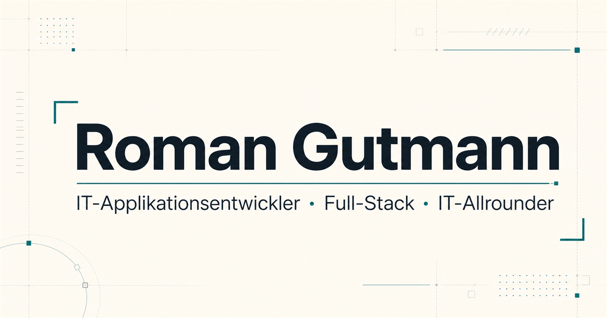

# Roman Gutmann – Portfolio

[](https://roman-gutmann.at)

Zweisprachiges Bewerbungsportfolio eines IT-Applikationsentwicklers aus Niederösterreich. Die Website verbindet ausgewählte Projekte, technische Grundlagen und langjährige Berufspraxis in einer ruhigen, klaren und barrierebewussten Präsentation.

**Live:** [roman-gutmann.at](https://roman-gutmann.at)

## Funktionen

- deutsche und englische Inhalte mit eindeutigen Sprachpfaden
- responsive Start- und Projektseiten
- strukturierte Projektbeschreibungen mit Rolle, Beiträgen und Erkenntnissen
- optimierte Bilder und eigene Open-Graph-Vorschau
- Lebenslauf als PDF in deutscher und englischer Sprache
- semantisches HTML, Skip-Link und klar erkennbare Fokuszustände
- Sitemap, Canonical URLs, Sprachalternativen und strukturierte Personendaten

## Technische Umsetzung

- [Astro](https://astro.build/) für die statische Seitengenerierung
- TypeScript für strukturierte Inhalts- und Projektdaten
- Tailwind CSS und eigene globale Styles für das visuelle System
- Sharp und Astro Assets für optimierte Bildausgabe
- GitHub Actions für Prüfung, Build und Deployment
- GitHub Pages mit eigener Domain und erzwungenem HTTPS

Die Inhalte sind bewusst in Daten, Content Collections und wiederverwendbare Komponenten getrennt. Dadurch bleiben Sprachversionen, Projektdetails und gemeinsame Layout-Bausteine konsistent pflegbar.

## Projektstruktur

```text
src/
├── components/    Wiederverwendbare Oberflächenbausteine
├── content/       Zweisprachige Projektinhalte
├── data/          Seitentexte und strukturierte Daten
├── layouts/       Gemeinsames HTML-, SEO- und Social-Media-Layout
├── pages/         Deutsche und englische Routen
└── styles/        Globales visuelles System
public/           Statische Projektbilder, Lebensläufe und Metadaten
```

## Lokale Entwicklung

Voraussetzungen: Node.js 24 und pnpm 11.

```sh
pnpm install
pnpm dev
```

## Prüfung und Build

```sh
pnpm check
pnpm build
```

Die statische Ausgabe wird unter `dist/` erzeugt und nach erfolgreicher Prüfung per GitHub Actions auf GitHub Pages veröffentlicht.

Der unveränderte Stand der ersten statischen Homepage ist über den Git-Tag `legacy-static-v1` gesichert.
